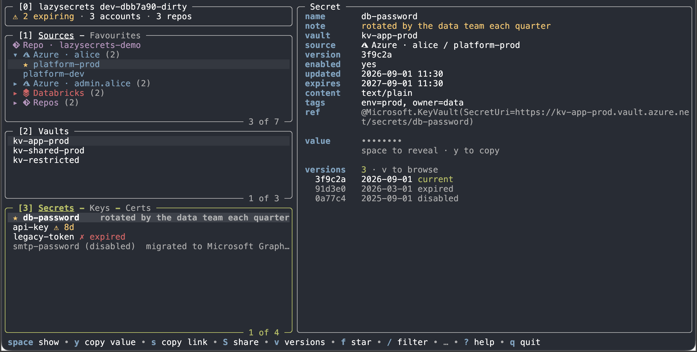
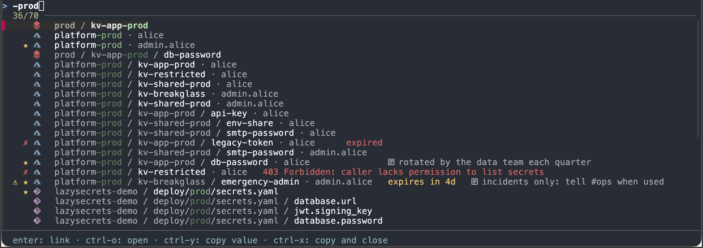

# lazysecrets

A terminal UI for finding, reading and sharing secrets. Inspired by the fantastic [lazygit](https://github.com/jesseduffield/lazygit).



## Main features

- **Read-only**: lazysecrets never creates, changes or deletes a secret.
- **Zero setup**: uses the logins you already have (`az`, the Databricks
  CLI, `sops`, `git`). No config file needed.
- **Search everything**: `ctrl+s` searches every source at once, with
  fzf-style matching.
- **Share links**: Share `lazysecrets://` links with colleagues.
- **Careful with values**: values stay hidden until you reveal them, and
  copied values are cleared from the clipboard after 30 seconds.
- **Scriptable**: `get`, `list` and `open` for scripts, fzf and editor
  pickers; [lazysecrets.nvim](https://github.com/karleinarb/lazysecrets.nvim)
  for Neovim.
- **Favourites**: star the secrets you use most for easy access.
- **Expiry warnings**: secrets, keys and certificates that expire soon are
  marked, listed together in the status pane.
- **Your way**: rebind any key, pick a theme, and add custom commands to run
  on a secret.
- **Try it first**: `lazysecrets --demo` runs on built-in sample data.
- **Sources**: Azure Key Vault, Databricks secret scopes, and SOPS, `.env` and Spring Boot config files in your git repos.

> **Early development:** expect rough edges. See [CHANGELOG.md](CHANGELOG.md) for what's new.

## Install

On macOS or Linux (arm64 or x86_64):
```sh
curl -fsSL https://raw.githubusercontent.com/karleinarb/lazysecrets/main/install.sh | sh
```
Or
```sh
curl -fsSL https://git.kebcloud.no/keb/lazysecrets/raw/branch/main/install.sh | sh
```

Both approaches will install the latest release from [GitHub](https://github.com/karleinarb/lazysecrets/releases) with fallback to
[git.kebcloud.no](https://git.kebcloud.no/keb/lazysecrets/releases), into
`~/.local/bin` after checking it against the release's checksums.
`sh -s -- v0.2.0` installs a given version, `LAZYSECRETS_INSTALL_DIR`
somewhere else.

`U` (or `lazysecrets update`) updates in place when there's a newer
release.

Or build it yourself:
`go install git.kebcloud.no/keb/lazysecrets/cmd/lazysecrets@latest`.

## Get started

```sh
az login            # login with azure cli
lazysecrets         # start lazysecrets
lazysecrets --demo  # test with demo data
```

Pick a source on the left, then a vault, then a secret. With nothing
signed in yet, the right pane says how to get started. The keys you'll
use most:

| Key | Action |
|---|---|
| `j`/`k`, `enter`, `esc` | move, drill in, back |
| `l` / `h` | the details of what's selected / back |
| `/` | filter the list you're in |
| `space` | reveal / hide the value |
| `y` | copy the value |
| `ctrl+s` | Go to: search everything and jump there |
| `f` / `F` | star / your favourites |
| `s` | copy a link to share |
| `?` | every key, searchable |
| `q` | quit |

## Integration

`lazysecrets list`, `get` and `open` plug lazysecrets into fzf, editor
pickers and scripts: see [Integration](docs/integration.md#an-fzf-picker).



## Docs

- [Keys](docs/keys.md): every key, Go to, the layout, and rebinding keys
- [Azure Key Vault](docs/azure.md): accounts, permissions, pinned vaults
- [Databricks](docs/databricks.md): profiles and Key Vault-backed scopes
- [SOPS, .env and Spring files](docs/repos.md): which repos and files, decrypting
- [Sharing](docs/sharing.md): links to secrets, encrypted env files, and
  opening links, also from the browser and chat
- [Integration](docs/integration.md): how lazysecrets can integrate into other systems
- [Custom commands](docs/custom-commands.md): run your own commands on a
  secret
- [Config](docs/config.md): every option, themes, layered configs, the
  state file
- [Development](docs/development.md): building, tests, how changes land and
  releasing

## Privacy

lazysecrets never stores, caches or sends your secret values. It keeps the
names and metadata of what you've loaded in a cache file readable only by
you, to show it at once next time (`storage.cache: false` turns it off). It talks
only to the services you use it with, and collects no usage data. The one
call of its own is a daily check for a new release, on GitHub or else
git.kebcloud.no, which `updates.autoCheck: false` turns off.

## Repositories

The main repo of this codebase is at [git.kebcloud.no](https://git.kebcloud.no/keb/lazysecrets).
The [GitHub mirror](https://github.com/karleinarb/lazysecrets) is for discoverability, issue-tracking and releases.
It also makes it possible to give a ⭐ if you like lazysecrets!

## Contributing

I don't take pull requests as I don't have time to review and test them.
But bug reports and ideas are very welcome!
Open an [issue on GitHub](https://github.com/karleinarb/lazysecrets/issues) and I'll have a look.

## AI disclosure

Built with help from an agentic coding assistant. Every change is requested, reviewed and tested by me before it's merged.

## License

Copyright © 2026 Karl-Einar Bergstrøm.

lazysecrets is free software: you can redistribute it and/or modify it
under the terms of the GNU General Public License as published by the Free
Software Foundation, either version 3 of the License, or (at your option)
any later version. See [LICENSE](LICENSE).
